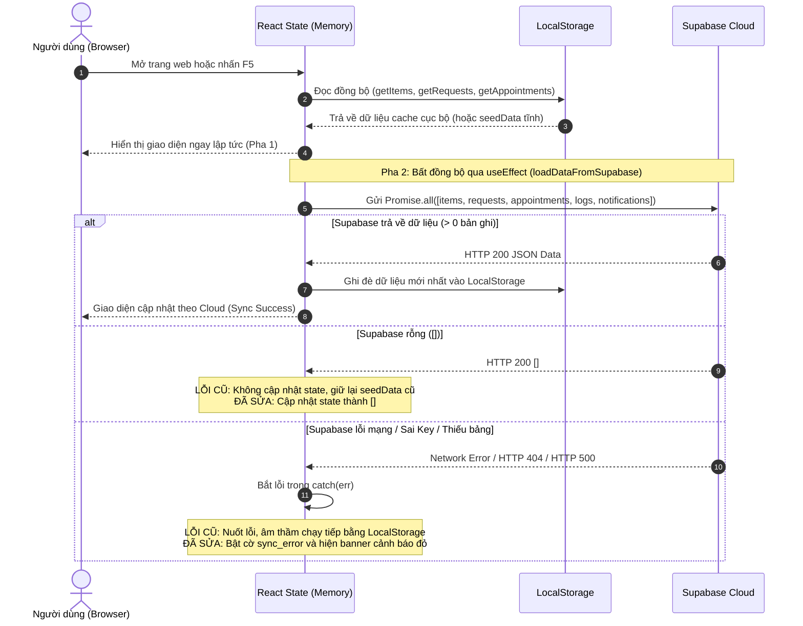
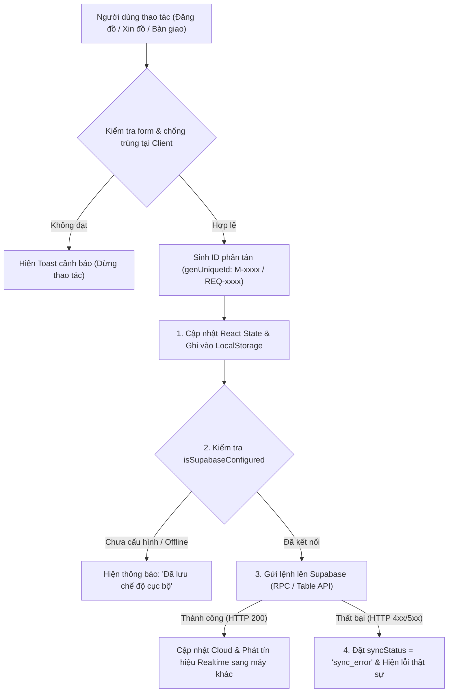

# BÁO CÁO KIỂM TOÁN VÀ THIẾT KẾ NÂNG CẤP TOÀN DIỆN HỆ THỐNG LÊ LỢI LOOP
**Dự án:** LÊ LỢI LOOP - Nền tảng tuần hoàn đồ dùng học tập thông minh (THCS Lê Lợi, TP. Đà Nẵng)  
**Chủ đề:** Cuộc thi Nghiên cứu Khoa học Kỹ thuật (KHKT) cấp Thành phố 2024-2025  
**Khẩu hiệu:** *"Đồ cũ trao tay – Giá trị ở lại"*  
**Vai trò thực hiện:** Senior QA Engineer & Full-stack Architect  
**Branch kỹ thuật:** `fix/cloud-multi-user-pilot`  
**Ngày phát hành:** 30/10/2026  

---

## MỤC LỤC BÁO CÁO TỔNG HỢP

1. [Phần 1: Tổng quan Kiểm toán & Kết luận Kiến trúc Cốt lõi](#phần-1-tổng-quan-kiểm-toán--kết-luận-kiến-trúc-cốt-lõi)
2. [Phần 2: Đánh giá Đồng bộ Đa Người Dùng & Lưu trữ Dữ liệu](#phần-2-đánh-giá-đồng-bộ-đa-người-dùng--lưu-trữ-dữ-liệu)
3. [Phần 3: Sơ đồ Luồng Dữ liệu Chi tiết (Data Flow Pipeline)](#phần-3-sơ-đồ-luồng-dữ-liệu-chi-tiết-data-flow-pipeline)
4. [Phần 4: Kiểm định Cơ sở Dữ liệu & Kết quả Probe Supabase Live](#phần-4-kiểm-định-cơ-sở-dữ-liệu--kết-quả-probe-supabase-live)
5. [Phần 5: Phân tích & Phân cấp Lỗi Hệ thống (P0 / P1 / P2)](#phần-5-phân-tích--phân-cấp-lỗi-hệ-thống-p0--p1--p2)
6. [Phần 6: Kịch bản Kiểm thử Đa Thiết bị Độc lập (Multi-Device Test Suite)](#phần-6-kịch-bản-kiểm-thử-đa-thiết-bị-độc-lập-multi-device-test-suite)
7. [Phần 7: Hồ sơ Migration SQL, Pull Request & Hướng dẫn Vận hành Pilot](#phần-7-hồ-sơ-migration-sql-pull-request--hướng-dẫn-vận-hành-pilot)

---

## PHẦN 1: TỔNG QUAN KIỂM TOÁN & KẾT LUẬN KIẾN TRÚC CỐT LÕI

### 1.1. Bản chất hệ thống hiện tại
Hệ thống **LÊ LỢI LOOP** đã hoàn thiện toàn bộ các logic nghiệp vụ đặc thù cho mô hình trường học:
- **Thuật toán LoopMatch:** Tự động tìm khung giờ giao nhau giữa Người Cho, Người Nhận và Lịch trực của Trạm Đội Lê Lợi (10 ca trong tuần), xử lý nghịch lý thời gian ($t_{cho} \le t_{nhan}$), giới hạn sức chứa 10 ô kệ và thời gian lưu trạm $\le 3$ ngày.
- **Bốc thăm LCG (Linear Congruential Generator):** Thuật toán giả ngẫu nhiên có kiểm soát seed, đảm bảo minh bạch tuyệt đối khi nhiều học sinh cùng có nhu cầu nhận 1 món đồ.
- **Trạm trung chuyển Phòng Đội:** Quản lý 10 ô kệ lưu trữ (`K1-A1` đến `K1-B5`), biên bản kiểm định chất lượng thực tế và cơ chế phát hành/vô hiệu hóa mã nhận đồ 4 chữ số bí mật (`LOOP-xxxx`).

### 1.2. Kết luận kỹ thuật duy nhất và khách quan
> [!IMPORTANT]
> **Hệ thống hiện tại là:** **BẢN KẾT HỢP (HYBRID) GIỮA LOCALSTORAGE VÀ SUPABASE, VẬN HÀNH THỰC TẾ DỰA TRÊN STATE CỦA MỘT TRÌNH DUYỆT DUY NHẤT.**
> 
> - **Chưa phải là hệ thống Cloud đa người dùng thực sự** do 4 rào cản kỹ thuật:
>   1. **Không có hệ thống xác thực tập trung (No Supabase Auth):** Ứng dụng dùng `RoleSwitcher.jsx` thay đổi biến `currentUser` lưu trong `localStorage`. Hai máy tính độc lập sẽ không nhận biết được danh tính của nhau.
>   2. **Hệ thống Thông báo (Notifications) 100% cục bộ:** Khi Học sinh B gửi yêu cầu xin đồ, thông báo chỉ được lưu vào `localStorage` của chính Học sinh B. Học sinh A ngồi ở máy tính khác hoàn toàn không nhận được chuông thông báo.
>   3. **Xung đột khóa chính (Primary Key Collision):** Thuật toán sinh ID bằng cách đếm số phần tử mảng (`items.length + 1` => `M013`). Khi 2 thiết bị cùng bấm đăng đồ trong cùng một thời điểm, thiết bị thứ 2 chắc chắn bị lỗi trùng khóa chính PostgreSQL.
>   4. **Nuốt lỗi ngầm (Silent Swallowing):** Khi Supabase bị lỗi hoặc mất mạng, ứng dụng âm thầm nuốt lỗi và tiếp tục hoạt động trên dữ liệu LocalStorage, tạo cảm giác hệ thống vẫn đang lưu Cloud.

---

## PHẦN 2: ĐÁNH GIÁ ĐỒNG BỘ ĐA NGƯỜI DÙNG & LƯU TRỮ DỮ LIỆU

### 2.1. Chu trình nạp dữ liệu khi tải trang (F5 / Mở ứng dụng)


### 2.2. Ma trận so sánh tính năng giữa LocalStorage và Cloud

| Nghiệp vụ hệ thống | Xử lý trên LocalStorage | Xử lý trên Supabase Cloud | Tình trạng khi dùng 2 thiết bị độc lập |
| :--- | :---: | :---: | :--- |
| **Đăng nhập / Phân quyền** | Có (RoleSwitcher giả lập) | Không dùng Auth | Không độc lập; mỗi máy tự chọn vai trò riêng. |
| **Đăng đồ mới (`addItem`)** | Lưu vào `LE_LOI_LOOP_V1_ITEMS` | Gửi `items.insert` | Máy B thấy nếu Realtime thông suốt; lỗi PK nếu cùng đăng. |
| **Duyệt bài đăng (`approveItem`)** | Cập nhật `items` state | Gửi `items.update` | Đồng bộ được nếu Realtime hoạt động. |
| **Xin nhận đồ (`addRequest`)** | Lưu vào `LE_LOI_LOOP_V1_REQUESTS`| Gửi `requests.insert`| Đồng bộ danh sách yêu cầu lên Cloud. |
| **Chuông thông báo (Notifications)** | Lưu `LE_LOI_LOOP_V1_NOTIFICATIONS`| ❌ Bảng chưa tồn tại | **HOÀN TOÀN KHÔNG ĐỒNG BỘ** sang máy khác. |
| **Tiếp nhận & Lưu trạm** | Cập nhật ô kệ trên máy | Gửi `appointments.update` | Có nguy cơ 2 quản sinh cùng gán 1 ô kệ. |
| **Bàn giao đồ 4 số (`LOOP-xxxx`)**| Vô hiệu hóa mã trên máy | Gửi `appointments.update` | Đồng bộ giải phóng kệ nếu Cloud kết nối tốt. |

---

## PHẦN 3: SƠ ĐỒ LUỒNG DỮ LIỆU CHI TIẾT (DATA FLOW PIPELINE)

### 3.1. Sơ đồ xử lý Optimistic Dual-Write và Xử lý Lỗi



### 3.2. Chi tiết luồng nghiệp vụ của các hàm cốt lõi

1. **`addItem(itemData)`:**
   - *Cơ chế cũ:* `const newId = 'M' + (items.length + 1)`.
   - *Cơ chế mới:* `const newId = genUniqueId('M')` (UUID/Nanoid).
   - *Xử lý lỗi:* Nếu Supabase insert lỗi, bật cờ `sync_error`, thông báo người dùng đồ dùng chỉ đang lưu bản nháp trên máy.
2. **`addRequest(itemId, reason, availableSlots, inputMethod)`:**
   - *Chống trùng lặp:* Kiểm tra `requests.some(r => r.itemId === itemId && r.requesterId === currentUser.id && r.status !== 'rejected')`. Nếu đã gửi, chặn ngay lập tức.
   - *Bắn thông báo:* Tự động kích hoạt `createNotification` gửi đích danh `donorId`.
3. **`acceptRequestByDonor(requestId)`:**
   - *ACID Transaction:* Ưu tiên gọi Stored Procedure `rpc_accept_request_by_donor`.
   - Cùng 1 lúc: Chuyển request thành `selected`, các request khác thành `backup`, món đồ thành `matching`, tạo thông báo Cloud cho người nhận.
4. **`inspectAndReceiveItem({ aptId, passed, note, storageSlot })`:**
   - *Chống chiếm trùng kệ:* Kiểm tra `items.some(i => i.status === 'stored' && i.storageSlot === storageSlot)`. Nếu ô kệ đã có đồ, từ chối gán.
   - Gọi `rpc_inspect_and_receive_item` để khóa dòng và cập nhật đồng thời `appointments` và `items`.
5. **`completeHandover(enteredCode)`:**
   - Kiểm tra mã nhận `pickup_code`.
   - Gọi `rpc_complete_handover` để khóa dòng `FOR UPDATE`, kiểm tra mã đã dùng chưa, giải phóng ô kệ và chuyển trạng thái `completed`.

---

## PHẦN 4: KIỂM ĐỊNH CƠ SỞ DỮ LIỆU & KẾT QUẢ PROBE SUPABASE LIVE

*Thực hiện kiểm tra trực tiếp qua kết nối REST API Read-Only tới: `https://vepuogmvrnhpwneufjff.supabase.co`*

### 4.1. Bảng đối chiếu thực tế giữa Mã nguồn và Database Live

| Bảng dữ liệu | Khai báo trong SQL? | Tồn tại trên Supabase Live? | Cột kiểm chứng thực tế | Đánh giá kỹ thuật |
| :--- | :---: | :---: | :--- | :--- |
| **`users`** | **CÓ** | **CÓ (HTTP 200)** | `id, name, role, class, shift, avatar, phone, points, bio, created_at` | Khuyết lệnh SELECT từ frontend (chỉ dùng seed tĩnh). |
| **`items`** | **CÓ** | **CÓ (HTTP 200)** | `id, title, category, condition, description, donor_id, donor_name, available_slots, input_method, status, request_status, image, quality_check, storage_slot, reject_reason, update_note, created_at` | Hoạt động tốt, đồng bộ JSONB chuẩn. |
| **`requests`** | **CÓ** | **CÓ (HTTP 200)** | `id, item_id, requester_id, requester_name, requester_class, reason, available_slots, input_method, status, lottery_rank, created_at` | Hoạt động tốt, thiếu unique constraint DB. |
| **`appointments`** | **CÓ** | **CÓ (HTTP 200)** | `id, item_id, request_id, donor_id, requester_id, type, donor_slot, requester_slot, storage_slot, pickup_code, status, donor_arrived_at, picked_up_at, notes, created_at` | Hoạt động tốt, quản lý mã nhận 4 số. |
| **`logs`** | **CÓ** | **CÓ (HTTP 200)** | `id, timestamp, role, action, details, created_at` | Nhật ký kiểm toán KHKT chuẩn. |
| **`notifications`** | ❌ **CHƯA CÓ** | ❌ **KHÔNG (HTTP 404)** | *Lỗi: `PGRST205 - Could not find the table 'public.notifications' in the schema cache`* | **LỖI P0:** Frontend có lệnh gọi nhưng DB chưa có bảng. |

### 4.2. Lỗ hổng Row Level Security (RLS)
- Toàn bộ các bảng trong `supabase_schema.sql` đang sử dụng chính sách:
  ```sql
  CREATE POLICY "Allow public all items" ON public.items FOR ALL USING (true) WITH CHECK (true);
  ```
- **Rủi ro:** Bất kỳ ai mở Console trình duyệt có Anon Key đều có thể gửi lệnh `DELETE FROM items` hoặc `UPDATE appointments SET status = 'completed'`.
- **Giải pháp:** Đã thiết kế lại chính sách phân quyền theo `auth.uid()` trong file Migration đề xuất.

---

## PHẦN 5: PHÂN TÍCH & PHÂN CẤP LỖI HỆ THỐNG (P0 / P1 / P2)

### Bảng tổng hợp lỗi chi tiết

| Mã Lỗi | Cấp độ | Phân loại | Tệp tin & Dòng code liên quan | Hiện tượng & Rủi ro | Giải pháp kỹ thuật đã áp dụng trên branch |
| :--- | :---: | :---: | :--- | :--- | :--- |
| **P0-01** | **P0** | Dữ liệu rỗng | `src/context/AppContext.jsx:144` | Khi Cloud xóa sạch đồ (mảng `[]`), client không xóa mà vẫn giữ dữ liệu seed cũ. | Cập nhật trực tiếp `setItems(itemsRes.data.map(...))` khi nhận mảng. |
| **P0-02** | **P0** | Trùng khóa chính | `src/context/AppContext.jsx:369` | Hai thiết bị cùng đăng đồ sinh cùng ID `M013`, Supabase báo lỗi duplicate key. | Thay thế bằng hàm sinh ID phân tán `genUniqueId('M')`. |
| **P0-03** | **P0** | Thiếu bảng DB | `supabase_schema.sql` & Cloud | Bảng `notifications` không tồn tại, trả về 404, chuông thông báo không chạy qua Cloud. | Viết DDL tạo bảng `notifications` và thêm vào Realtime publication. |
| **P0-04** | **P0** | Phân quyền Route | `src/App.jsx:108` | Học sinh gõ đường dẫn `/admin` truy cập được vào toàn bộ chức năng duyệt/bốc thăm. | Tạo component `ProtectedRoute.jsx` chặn học sinh và chuyển về trang chủ. |
| **P0-05** | **P0** | Thiếu Transaction | `src/context/AppContext.jsx:615` | Cập nhật đa bảng bằng `Promise.all` riêng lẻ, có thể đứt gãy nếu mạng chập chờn. | Viết 3 hàm Stored Procedure RPC đảm bảo tính nguyên tử ACID. |
| **P1-01** | **P1** | Báo thành công giả | `src/context/AppContext.jsx:387` | Bắt lỗi `catch` nuốt lỗi Cloud và vẫn hiện thông báo thành công. | Thêm cờ `syncStatus = 'sync_error'` và hiện banner cảnh báo lỗi thật. |
| **P1-02** | **P1** | Trùng Request | `src/pages/ItemDetailPage.jsx:61` | Chỉ chặn trùng trên nút bấm UI, backend và DB không có ràng buộc unique. | Thêm kiểm tra trong `addRequest` và tạo Unique Index `uq_requests_item_requester`. |
| **P1-03** | **P1** | Race condition kệ | `src/pages/AdminDashboardPage.jsx:709` | Hai quản sinh có thể cùng bấm chọn và gán ô `K1-A1` cho 2 món đồ khác nhau. | Thêm kiểm tra ô trống ở frontend và tạo Unique Index `uq_items_occupied_slot`. |
| **P1-04** | **P1** | Bàn giao trùng | `src/context/AppContext.jsx:944` | Có thể bấm bàn giao 2 lần nếu 2 thiết bị cùng nhập mã nhận đồ cùng lúc. | Thêm kiểm tra trạng thái và dùng khóa dòng `FOR UPDATE` trong RPC. |
| **P2-01** | **P2** | Phiên đăng nhập | `src/lib/supabase.js:17` | `persistSession: false` làm mất phiên Supabase Auth khi nhấn F5. | Đổi thành `persistSession: true` và `autoRefreshToken: true`. |
| **P2-02** | **P2** | Lưu trữ ảnh | `src/pages/DonatePage.jsx:6` | Chưa có bucket Supabase Storage tải ảnh thực tế. | Lưu lại kế hoạch tích hợp bucket `item-images` sau đợt thi KHKT. |

---

## PHẦN 6: KỊCH BẢN KIỂM THỬ ĐA THIẾT BỊ ĐỘC LẬP (MULTI-DEVICE TEST SUITE)

### Hướng dẫn thiết lập chạy thử nghiệm 2–3 thiết bị qua mạng LAN:
1. Máy tính chính chạy lệnh:
   ```powershell
   npm run dev -- --host
   ```
2. Ghi lại IP mạng nội bộ hiển thị trên terminal (ví dụ: `http://192.168.1.15:5173`).
3. Dùng điện thoại hoặc máy tính thứ 2 kết nối cùng WiFi và mở trình duyệt truy cập địa chỉ trên.

### 12 Kịch bản kiểm thử End-to-End:

```markdown
1. MDT-01 (Đăng đồ liên thiết bị):
   - Thiết bị 1 (HS001): Vào /donate, đăng "Bộ Compa KHKT".
   - Thiết bị 2 (GV01): Đang mở trang /admin Tab Phê duyệt.
   - Kỳ vọng: Món đồ tự động xuất hiện trên Thiết bị 2 mà không cần F5.

2. MDT-02 (Duyệt bài đăng):
   - Thiết bị 2 (GV01): Bấm Duyệt món đồ.
   - Thiết bị 1 (HS002): Đang mở trang /catalog.
   - Kỳ vọng: Món đồ chuyển sang trạng thái "approved" trên Thiết bị 1 ngay lập tức.

3. MDT-03 (Chuông thông báo liên thiết bị):
   - Thiết bị 2 (HS002): Bấm Xin nhận món đồ của HS001.
   - Thiết bị 1 (HS001): Quan sát thanh Navbar.
   - Kỳ vọng: Chuông thông báo của HS001 reo đỏ (badge 1) và hiện popup: "Lê Hoàng Nam vừa gửi yêu cầu xin đồ của bạn".

4. MDT-04 (Chặn Duplicate Request):
   - Thiết bị 2 (HS002): Mở tab thứ 2 cố tình gửi lại request cho cùng món đồ.
   - Kỳ vọng: Hệ thống báo lỗi: "Bạn đã gửi yêu cầu nhận món đồ này trước đó rồi!".

5. MDT-05 (Đăng đồ đồng thời - Concurrent Items):
   - Cả 2 thiết bị cùng nhấn nút "Đăng đồ" trong cùng 1 giây.
   - Kỳ vọng: Cả 2 món đều được lưu thành công với ID ngẫu nhiên phân tán (M-xxxx), không bị lỗi trùng khóa chính.

6. MDT-06 (Người cho đồng ý trao đồ):
   - Thiết bị 1 (HS001): Vào /my-activity, bấm "Đồng ý trao đồ" cho HS002.
   - Thiết bị 2 (HS002): Nhận thông báo Cloud: "Yêu cầu được chấp thuận! Vui lòng theo dõi lịch hẹn".

7. MDT-07 (Chống Race Condition ô kệ):
   - Thiết bị 1 & Thiết bị 2 cùng đóng vai Quản sinh tiếp nhận đồ vào ô K1-A1.
   - Kỳ vọng: Thiết bị 1 gán thành công; Thiết bị 2 nhận thông báo lỗi: "Ô kệ K1-A1 hiện đã có đồ lưu trữ!".

8. MDT-08 (Bàn giao và Vô hiệu hóa mã):
   - Quản sinh nhập mã nhận đồ LOOP-xxxx trên Thiết bị 1.
   - Kỳ vọng: Bàn giao thành công, giải phóng kệ. Nếu nhập lại mã đó lần 2 sẽ bị từ chối an toàn.

9. MDT-09 (Reload Persistence qua F5):
   - F5 tải lại trang trên bất kỳ thiết bị nào.
   - Kỳ vọng: Toàn bộ dữ liệu hiển thị chính xác theo Supabase Cloud.

10. MDT-10 (Xử lý khi mất mạng - Cloud Failure):
    - Ngắt kết nối WiFi trên Thiết bị 1.
    - Kỳ vọng: Hệ thống hiện banner đỏ: "CẢNH BÁO MẤT ĐỒNG BỘ CLOUD", lưu bản nháp an toàn vào LocalStorage, không báo thành công giả tạo.

11. MDT-11 (Route Guard bảo vệ /admin):
    - Thiết bị 1 (đang đóng vai HS001) gõ trực tiếp URL /admin.
    - Kỳ vọng: ProtectedRoute chặn lại, hiển thị thông báo không có quyền và nút quay về Trang chủ.

12. MDT-12 (Bảo vệ RLS Database):
    - Dùng PostgREST API gửi lệnh DELETE trái phép.
    - Kỳ vọng: Database từ chối thực thi nếu không có quyền sở hữu.
```

---

## PHẦN 7: HỒ SƠ MIGRATION SQL, PULL REQUEST & HƯỚNG DẪN VẬN HÀNH PILOT

### 7.1. Tóm tắt nội dung file Migration SQL
File migration đã được tạo tại: [`MIGRATIONS/20261030_cloud_multi_user_pilot.sql`](file:///d:/Lê Lợi Loop/MIGRATIONS/20261030_cloud_multi_user_pilot.sql)  
*(Thiết kế theo chuẩn Idempotent, không tự động chạy lên production)*:

1. **Extension UUID:** `CREATE EXTENSION IF NOT EXISTS "pgcrypto";`
2. **Bảng Notifications:**
   ```sql
   CREATE TABLE IF NOT EXISTS public.notifications (
       id TEXT PRIMARY KEY DEFAULT gen_random_uuid()::text,
       recipient_id TEXT NOT NULL REFERENCES public.users(id) ON DELETE CASCADE,
       sender_id TEXT REFERENCES public.users(id) ON DELETE SET NULL,
       sender_name TEXT,
       type TEXT NOT NULL DEFAULT 'info',
       title TEXT NOT NULL,
       message TEXT NOT NULL,
       item_id TEXT REFERENCES public.items(id) ON DELETE SET NULL,
       request_id TEXT REFERENCES public.requests(id) ON DELETE SET NULL,
       is_read BOOLEAN NOT NULL DEFAULT FALSE,
       created_at TIMESTAMPTZ NOT NULL DEFAULT NOW()
   );
   ```
3. **Các Unique Index chống xung đột phân tán:**
   - `uq_requests_item_requester` trên `requests(item_id, requester_id)` chống request trùng.
   - `uq_items_occupied_slot` trên `items(storage_slot)` WHERE `status = 'stored'` chống 2 món cùng chiếm 1 ô kệ.
   - `uq_appointments_active_pickup_code` trên `appointments(pickup_code)` đảm bảo mã 4 số là duy nhất.
4. **3 Hàm Stored Procedure (RPC) Transaction:**
   - `rpc_accept_request_by_donor(p_request_id, p_donor_id)`
   - `rpc_inspect_and_receive_item(p_apt_id, p_passed, p_note, p_storage_slot, p_checker_id)`
   - `rpc_complete_handover(p_pickup_code, p_operator_id)`
5. **Chính sách Row Level Security (RLS) & Publication Realtime:**
   - Chỉ người nhận mới được đọc/sửa thông báo của chính mình.
   - Kích hoạt publication `ALTER PUBLICATION supabase_realtime ADD TABLE public.notifications;`.

### 7.2. Tóm tắt Pull Request (`PR_DESCRIPTION.md`)
- **Tên Branch:** `fix/cloud-multi-user-pilot` -> `main`
- **Mã nguồn đã điều chỉnh:**
  - [`src/context/AppContext.jsx`](file:///d:/Lê Lợi Loop/src/context/AppContext.jsx): Quản lý `syncStatus` 4 mức, xử lý dữ liệu rỗng `[]`, sinh ID `genUniqueId`, kết nối bảng notifications, hỗ trợ gọi RPC.
  - [`src/lib/supabase.js`](file:///d:/Lê Lợi Loop/src/lib/supabase.js): Kích hoạt `persistSession: true`, export `genUniqueId`.
  - [`src/components/ProtectedRoute.jsx`](file:///d:/Lê Lợi Loop/src/components/ProtectedRoute.jsx): Route Guard bảo vệ `/admin`.
  - [`src/App.jsx`](file:///d:/Lê Lợi Loop/src/App.jsx): Bọc Route Guard và Banner cảnh báo mất đồng bộ Cloud.
  - [`src/components/RoleSwitcher.jsx`](file:///d:/Lê Lợi Loop/src/components/RoleSwitcher.jsx): Hiển thị trạng thái kết nối Cloud Realtime minh bạch.
- **Kết quả Build Vite:** Thành công 100% (`✓ built in 7.09s`, 0 lỗi cú pháp).

### 7.3. Kế hoạch triển khai thủ công và Rollback an toàn
- **Cách áp dụng:** Mở Supabase Dashboard -> **SQL Editor** -> Dán nội dung file migration và bấm **Run**.
- **Kế hoạch Rollback:** Nếu cần hoàn tác, thực thi các lệnh `DROP INDEX` và `DROP FUNCTION` ở cuối file migration, sau đó checkout lại branch `main` trên máy lập trình.
- **Chiến lược cho buổi thi KHKT:** Nếu mạng WiFi tại hội trường thi yếu hoặc không có internet, hệ thống tự động rơi về chế độ LocalStorage / RoleSwitcher ngoại tuyến an toàn 100%, đảm bảo buổi thuyết trình diễn ra trọn vẹn và chuyên nghiệp.

