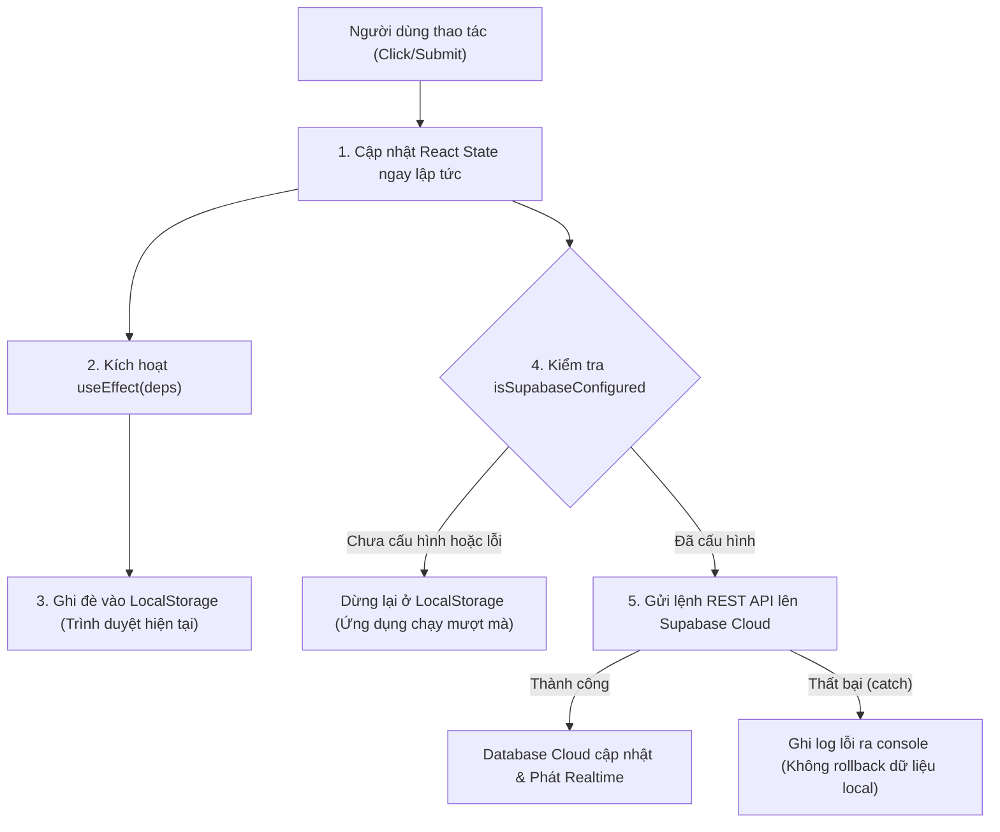

# SƠ ĐỒ VÀ PHÂN TÍCH LUỒNG DỮ LIỆU (DATA FLOW ANALYSIS)
**Dự án:** LÊ LỢI LOOP  
**File nguồn kiểm tra:** [`src/context/AppContext.jsx`](file:///d:/Lê Lợi Loop/src/context/AppContext.jsx)  

---

## 1. MÔ HÌNH TỔNG QUÁT CỦA CÁC HÀM XỬ LÝ (MUTATION PIPELINE)

Hầu hết các thao tác cập nhật dữ liệu trong hệ thống đều đi theo mô hình **Optimistic Dual-Write (Ghi lạc quan đồng thời hai tầng)**:



---

## 2. CHI TIẾT LUỒNG DỮ LIỆU CỦA TỪNG CHỨC NĂNG CỤ THỂ

### 1. Hàm `addItem(itemData)` - Đăng món đồ mới
- **Dòng mã:** [`src/context/AppContext.jsx:368-398`](file:///d:/Lê Lợi Loop/src/context/AppContext.jsx#L368-L398).
- **Cơ chế sinh ID:**
  ```javascript
  const nextNum = items.length + 1;
  const newId = `M${String(nextNum).padStart(3, '0')}`;
  ```
  *(Nguy cơ: Nếu 2 máy cùng có 12 món đồ, cả 2 sẽ cùng sinh ra ID `M013`, dẫn đến lỗi Duplicate Key trên Database)*.
- **Nơi lưu:**
  - **React State:** `setItems(prev => [newItem, ...prev])` (Lưu ngay lập tức).
  - **LocalStorage:** Được ghi tự động qua `useEffect` vào key `LE_LOI_LOOP_V1_ITEMS`.
  - **Supabase Cloud:** Gọi `await supabase.from('items').insert([mapItemToDb(newItem)])`.
  - **Ghi chú lỗi:** Nếu Supabase lỗi, khối `catch` chỉ `console.error('Supabase addItem error:', err)`. Trình duyệt của người đăng vẫn hiển thị món đồ bình thường (chỉ lưu trong máy họ).

---

### 2. Hàm `addRequest(itemId, reason, availableSlots, inputMethod)` - Gửi yêu cầu nhận đồ
- **Dòng mã:** [`src/context/AppContext.jsx:462-509`](file:///d:/Lê Lợi Loop/src/context/AppContext.jsx#L462-L509).
- **Cơ chế sinh ID:** `REQ-${String(requests.length + 1).padStart(3, '0')}` (Cùng nguy cơ xung đột ID nếu 2 máy cùng bấm).
- **Nơi lưu:**
  - **React State:** `setRequests(prev => [newReq, ...prev])`.
  - **LocalStorage:** Lưu vào `LE_LOI_LOOP_V1_REQUESTS`.
  - **Supabase Cloud:** `supabase.from('requests').insert([mapRequestToDb(newReq)])`.
- **Hành vi thông báo kèm theo:**
  - Gọi hàm `createNotification(...)` để gửi tin nhắn đến Người Cho (`donorId`).
  - **CỰC KỲ QUAN TRỌNG:** Bản ghi thông báo này **CHỈ LƯU VÀO STATE CỦA TRÌNH DUYỆT HIỆN TẠI**. Nó không thể truyền sang máy tính của Người Cho nếu Người Cho đang mở ở một máy tính khác!

---

### 3. Hàm `createNotification(...)` - Tạo thông báo hệ thống
- **Dòng mã:** [`src/context/AppContext.jsx:304-343`](file:///d:/Lê Lợi Loop/src/context/AppContext.jsx#L304-L343).
- **Nơi lưu:**
  - **React State:** `setNotifications(prev => [newNotif, ...prev])`.
  - **LocalStorage:** Lưu vào `LE_LOI_LOOP_V1_NOTIFICATIONS`.
  - **Supabase Cloud:** Có dòng lệnh `await supabase.from('notifications').insert(...)`, nhưng:
    - Bảng `notifications` **KHÔNG TỒN TẠI** trong file `supabase_schema.sql`.
    - Lỗi bị nuốt bằng `catch (e) { // fail silently }`.
    - Hàm `loadDataFromSupabase` hoàn toàn không có lệnh đọc bảng này.
  - **Kết luận:** Chức năng thông báo **100% LÀ CỤC BỘ TRÊN MỘT THIẾT BỊ**.

---

### 4. Hàm `approveItem(itemId)` & `rejectItem(itemId)` - Phê duyệt bài đăng
- **Dòng mã:** [`src/context/AppContext.jsx:401-439`](file:///d:/Lê Lợi Loop/src/context/AppContext.jsx#L401-L439).
- **Nơi lưu:**
  - **React State:** Cập nhật trường `status: 'approved' | 'rejected'`, `requestStatus: 'open' | 'closed'`.
  - **LocalStorage:** Đồng bộ qua `useEffect`.
  - **Supabase Cloud:** `supabase.from('items').update(...).eq('id', itemId)`.
- **Đồng bộ đa thiết bị:** Nếu Supabase kết nối thành công, trigger Realtime của Supabase sẽ báo hiệu sang các máy khác để gọi `loadDataFromSupabase()` cập nhật lại giao diện.

---

### 5. Hàm `acceptRequestByDonor(requestId)` - Người cho đồng ý tặng
- **Dòng mã:** [`src/context/AppContext.jsx:609-658`](file:///d:/Lê Lợi Loop/src/context/AppContext.jsx#L609-L658).
- **Nơi lưu:**
  - **React State:** Chuyển request được chọn sang `status: 'selected'`, các request khác thành `backup`. Cập nhật item sang `status: 'matching'`.
  - **LocalStorage:** Cập nhật 2 danh sách `items` và `requests`.
  - **Supabase Cloud:** Chạy `Promise.all` cập nhật song song bảng `requests` và `items`.
  - **Thông báo:** Tạo thông báo `request_accepted` cho Người Nhận (chỉ lưu cục bộ trên máy Người Cho).

---

### 6. Hàm `confirmAppointment(...)` - Chốt lịch hẹn & Sinh mã nhận
- **Dòng mã:** [`src/context/AppContext.jsx:683-737`](file:///d:/Lê Lợi Loop/src/context/AppContext.jsx#L683-L737).
- **Nơi lưu:**
  - **React State:** Tạo bản ghi `appointments` mới với mã bảo mật `generatePickupCode()`.
  - **LocalStorage:** Lưu vào `LE_LOI_LOOP_V1_APPOINTMENTS`.
  - **Supabase Cloud:** `supabase.from('appointments').insert(...)`.

---

### 7. Hàm `inspectAndReceiveItem(...)` - Tiếp nhận tại Trạm Phòng Đội
- **Dòng mã:** [`src/context/AppContext.jsx:804-941`](file:///d:/Lê Lợi Loop/src/context/AppContext.jsx#L804-L941).
- **Nơi lưu:**
  - **React State:** Cập nhật trạng thái appointment sang `ready_for_pickup`, gán ô kệ `storageSlot`, ghi chú biên bản kiểm định.
  - **LocalStorage:** Lưu đè state mới.
  - **Supabase Cloud:** Cập nhật đồng thời bảng `appointments` và `items`.

---

### 8. Hàm `completeHandover(enteredCode)` - Xác nhận bàn giao & Giải phóng kệ
- **Dòng mã:** [`src/context/AppContext.jsx:944-1017`](file:///d:/Lê Lợi Loop/src/context/AppContext.jsx#L944-L1017).
- **Nơi lưu:**
  - **React State:** Chuyển trạng thái `completed`, xóa gán ô kệ `storageSlot: null` để giải phóng vị trí.
  - **LocalStorage:** Lưu đè vào ổ cứng.
  - **Supabase Cloud:** Cập nhật trạng thái `completed` trên cả 2 bảng `appointments` và `items`.

---

## 3. TỔNG KẾT LUỒNG DỮ LIỆU TRÊN TOÀN HỆ THỐNG

| Chức năng | Ghi LocalStorage | Ghi Supabase Cloud | Đọc từ LocalStorage | Đọc từ Supabase Cloud | Nguy cơ khi mất mạng / Lỗi DB |
| :--- | :---: | :---: | :---: | :---: | :--- |
| **User & Role** | Có | Không | Có | Không | Không có tài khoản thực tế |
| **Items (Đồ dùng)** | Có | Có | Có (Khi mở app) | Có (Sau khi mở app) | Tiếp tục dùng cache cũ, không crash |
| **Requests (Yêu cầu)** | Có | Có | Có (Khi mở app) | Có (Sau khi mở app) | Tiếp tục dùng cache cũ |
| **Appointments (Lịch hẹn)**| Có | Có | Có (Khi mở app) | Có (Sau khi mở app) | Tiếp tục dùng cache cũ |
| **Logs (Kiểm toán)** | Có | Có | Có (Khi mở app) | Có (Sau khi mở app) | Tiếp tục dùng cache cũ |
| **Notifications (Thông báo)**| **Có** | **KHÔNG** | **Có** | **KHÔNG** | **Mất hoàn toàn tính năng thông báo liên máy tính** |

