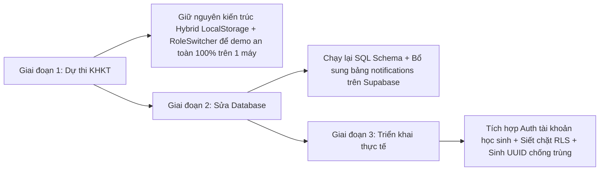

# DANH SÁCH GIẢI PHÁP VÀ ĐỀ XUẤT CẢI TIẾN (RECOMMENDED FIXES)
**Dự án:** LÊ LỢI LOOP  
**Mục tiêu:** Nâng cấp hệ thống từ mô hình Hybrid Demo lên hệ thống Đa người dùng Cloud hoàn chỉnh phục vụ vận hành thực tế tại Trường THCS Lê Lợi.  

---

## 1. NHÓM KHẮC PHỤC CẤP THIẾT (CẦN XỬ LÝ ĐỂ DATABASE SUPABASE CHẠY ĐÚNG)

### 🔴 Việc 1: Sửa lỗi chạy Script SQL trên Supabase Dashboard
- **Hiện tượng:** Khi chạy file `supabase_schema.sql`, Supabase dừng lại ở dòng 100 với lỗi `policy ... already exists`.
- **Nguyên nhân:** File SQL trước đó chưa có lệnh `DROP POLICY IF EXISTS`.
- **Giải pháp:**
  - Nhóm tác giả cần copy toàn bộ nội dung file [`supabase_schema.sql`](file:///d:/Lê Lợi Loop/supabase_schema.sql) đã được chuẩn hóa mới nhất, mở Supabase Dashboard -> **SQL Editor** -> Dán vào và bấm **Run**.
  - Kiểm tra kết quả trả về `Success. No rows returned`.

---

### 🔴 Việc 2: Thêm Bảng `notifications` vào Database và kích hoạt Realtime
- **Vấn đề:** Bảng `notifications` đang bị thiếu, khiến mọi thông báo gửi qua Cloud đều bị lỗi ngầm.
- **Giải pháp SQL cần bổ sung:**
  ```sql
  -- Tạo bảng notifications
  CREATE TABLE IF NOT EXISTS public.notifications (
      id TEXT PRIMARY KEY,
      recipient_id TEXT NOT NULL REFERENCES public.users(id) ON DELETE CASCADE,
      sender_id TEXT REFERENCES public.users(id) ON DELETE SET NULL,
      sender_name TEXT,
      type TEXT NOT NULL,
      title TEXT NOT NULL,
      message TEXT NOT NULL,
      item_id TEXT REFERENCES public.items(id) ON DELETE SET NULL,
      request_id TEXT REFERENCES public.requests(id) ON DELETE SET NULL,
      is_read BOOLEAN DEFAULT FALSE,
      created_at TIMESTAMPTZ DEFAULT NOW()
  );

  -- Kích hoạt RLS
  ALTER TABLE public.notifications ENABLE ROW LEVEL SECURITY;
  DROP POLICY IF EXISTS "Allow public all notifications" ON public.notifications;
  CREATE POLICY "Allow public all notifications" ON public.notifications FOR ALL USING (true) WITH CHECK (true);

  -- Thêm vào kênh Realtime
  ALTER PUBLICATION supabase_realtime ADD TABLE public.notifications;
  ```

---

### 🔴 Việc 3: Bổ sung lắng nghe thông báo trên Frontend ([`AppContext.jsx`](file:///d:/Lê Lợi Loop/src/context/AppContext.jsx))
- **Giải pháp:**
  1. Trong hàm `loadDataFromSupabase`, thêm truy vấn nạp bảng `notifications`:
     ```javascript
     const notifsRes = await supabase.from('notifications').select('*').order('created_at', { ascending: false });
     if (!notifsRes.error && notifsRes.data) {
       setNotifications(notifsRes.data.map(mapNotificationFromDb));
     }
     ```
  2. Trong kênh Realtime, thêm sự kiện lắng nghe:
     ```javascript
     .on('postgres_changes', { event: '*', schema: 'public', table: 'notifications' }, () => {
       loadDataFromSupabase();
     })
     ```
- **Kết quả sau khi sửa:** Khi Máy B bấm xin đồ, Máy A sẽ lập tức nhận được chuông thông báo qua Cloud trong vòng 0.5 giây!

---

## 2. NHÓM NÂNG CẤP KIẾN TRÚC ĐA THIẾT BỊ (ĐỂ TRIỂN KHAI TOÀN TRƯỜNG THỰC TẾ)

### 🟡 Việc 4: Khắc phục Xung đột Khóa chính (Primary Key Collision)
- **Vấn đề:** Tạo mã kiểu `M013` bằng `items.length + 1` sẽ bị trùng khi nhiều máy cùng tạo.
- **Giải pháp:**
  Thay thế cơ chế đếm mảng bằng chuỗi ngẫu nhiên định danh duy nhất (UUID hoặc Timestamp + Nanoid):
  ```javascript
  // Thay vì items.length + 1:
  const newId = `M-${Date.now().toString(36).toUpperCase()}-${Math.floor(Math.random() * 1000).toString().padStart(3, '0')}`;
  ```
  *(Ví dụ sinh ra mã: `M-M1A8B2-045`, đảm bảo 1 triệu học sinh cùng bấm đồng thời cũng không bao giờ bị trùng mã).*

---

### 🟡 Việc 5: Tích hợp Supabase Auth với Email học sinh `@thcsleloi.edu.vn`
- **Vấn đề:** Hiện tại ai cũng có thể giả mạo làm Quản trị viên `GV01` bằng RoleSwitcher.
- **Giải pháp sau cuộc thi:**
  - Kích hoạt Supabase Auth.
  - Sử dụng hàm `supabase.auth.signInWithPassword({ email, password })`.
  - Liên kết bảng `public.users` với bảng `auth.users` thông qua khóa ngoại `id = auth.uid()`.
  - Cập nhật chính sách RLS:
    ```sql
    -- Chỉ cho phép người sở hữu sửa bài của mình:
    CREATE POLICY "Users can only update their own items" 
    ON public.items FOR UPDATE 
    USING (auth.uid() = donor_id);
    ```

---

## 3. LỘ TRÌNH THỰC HIỆN ĐỀ XUẤT



