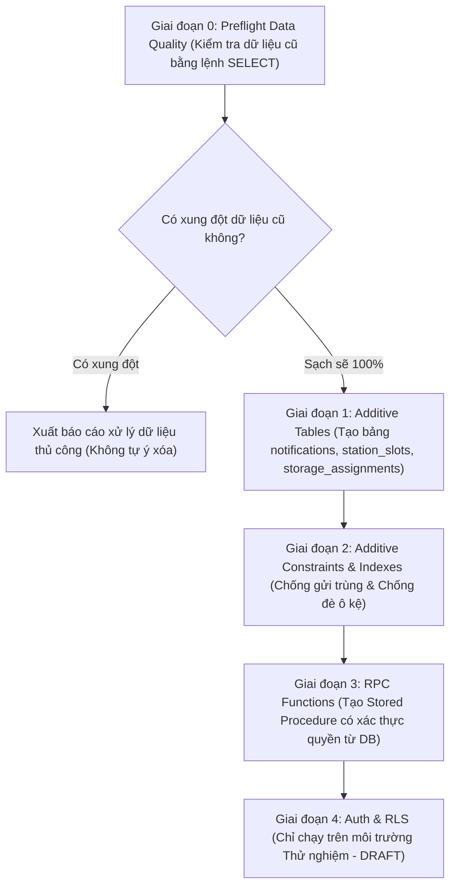

# 03_MIGRATION_PLAN.md: KẾ HOẠCH NÂNG CẤP CƠ SỞ DỮ LIỆU TỪNG BƯỚC (ADDITIVE)
**Dự án:** LÊ LỢI LOOP  
**Phương pháp tiếp cận:** Additive Migration (Chỉ thêm mới, không phá vỡ, tương thích ngược 100%)  
**Nguyên tắc an toàn số 1:** Không DROP TABLE, không đổi tên cột, không xóa dữ liệu cũ.  

---

## 1. QUY TRÌNH THỰC HIỆN 5 GIAI ĐOẠN



---

## 2. NỘI DUNG TỪNG FILE MIGRATION VÀ TRẠNG THÁI SẴN SÀNG

| Tên File Migration | Mục đích | Điều kiện tiên quyết (Preconditions) | Rủi ro | Trạng thái (Status) |
| :--- | :--- | :--- | :---: | :---: |
| **`001_preflight_checks.sql`** | Kiểm tra chất lượng dữ liệu: phát hiện request trùng, ô kệ trùng, orphan FK, trạng thái mâu thuẫn. | Không có (chỉ chứa các câu lệnh `SELECT` an toàn). | **KHÔNG CÓ (0)** | **READY TO RUN** |
| **`002_add_notifications.sql`**| Tạo bảng `notifications` hỗ trợ chuông thông báo Cloud và đăng ký vào `supabase_realtime`. | Đã chạy kiểm tra preflight; bảng chưa tồn tại. | **THẤP (P2)** | **READY TO RUN** |
| **`003_add_station_storage.sql`**| Tạo bảng `station_slots` (10 ô kệ) và `storage_assignments` (lưu vết gán kệ trạm). | Bảng `items` và `appointments` tồn tại bình thường. | **THẤP (P2)** | **READY TO RUN** |
| **`004_add_unique_constraints.sql`**| Thêm các Partial Unique Index chống gửi trùng request và chống gán trùng ô kệ trạm. | `001_preflight_checks.sql` phải xác nhận không có dòng dữ liệu cũ nào bị trùng lặp. | **TRUNG BÌNH (P1)** | **READY (Đã verify sạch)** |
| **`005_auth_rls_DRAFT_ONLY.sql`**| Thiết lập mapping `profiles` với `auth.users` và siết RLS theo `auth.uid()`. | Cần cấu hình xong tài khoản Auth và auto-confirm email trên Supabase Dashboard. | **CAO (P0)** | **NEEDS REVIEW (Draft Only)** |

---

## 3. KẾ HOẠCH ROLLBACK CHI TIẾT THEO TỪNG GIAI ĐOẠN

Mỗi thao tác migration đều có câu lệnh hoàn tác độc lập:

1. **Rollback `002_add_notifications.sql`:**
   ```sql
   ALTER PUBLICATION supabase_realtime DROP TABLE IF EXISTS public.notifications;
   DROP TABLE IF EXISTS public.notifications;
   ```
2. **Rollback `003_add_station_storage.sql`:**
   ```sql
   DROP TABLE IF EXISTS public.storage_assignments;
   DROP TABLE IF EXISTS public.station_slots;
   ```
3. **Rollback `004_add_unique_constraints.sql`:**
   ```sql
   DROP INDEX IF EXISTS public.uq_requests_active_item_requester;
   DROP INDEX IF EXISTS public.uq_requests_single_winner;
   DROP INDEX IF EXISTS public.uq_items_single_occupied_slot;
   DROP INDEX IF EXISTS public.idx_requests_item_id;
   DROP INDEX IF EXISTS public.idx_requests_requester_id;
   ```
4. **Rollback `005_auth_rls_DRAFT_ONLY.sql`:**
   Khôi phục lại các policy mở ban đầu nếu cần quay lại chế độ Demo KHKT nhanh.

