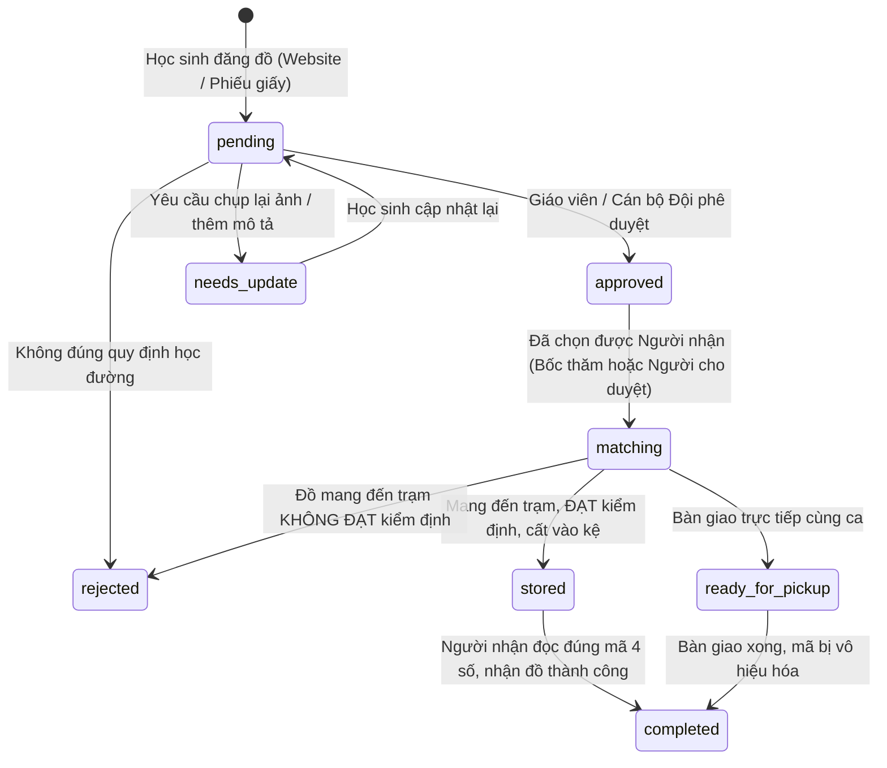

# 05_BUSINESS_RULES.md: QUY TẮC NGHIỆP VỤ & RÀNG BUỘC HỆ THỐNG LÊ LỢI LOOP
**Dự án:** LÊ LỢI LOOP - Nền tảng Tuần hoàn Đồ dùng Học tập THCS Lê Lợi  
**Địa điểm thực tế:** Trạm điều phối tại Phòng Đội - Phân hiệu Trường THCS Lê Lợi, TP. Đà Nẵng  

---

## 1. VÒNG ĐỜI VÀ QUY TẮC MÓN ĐỒ HỌC TẬP (`items`)

### Ràng buộc nghiệp vụ món đồ:
1. **Quyền sở hữu:** Học sinh chỉ có thể sửa bài đăng của mình khi món đồ đang ở trạng thái `pending` hoặc `needs_update`. Khi đã `approved` hoặc `matching`, không được tự ý sửa nội dung.
2. **Không tự xin đồ của mình:** Hệ thống cấm tuyệt đối học sinh gửi request xin nhận lại món đồ do chính mình đăng (`donor_id != requester_id`).
3. **Mỗi thời điểm chỉ mở nhận yêu cầu cho đồ có sẵn:** Khi món đồ chuyển sang `matching`, trường `request_status` lập tức chuyển thành `closed`.

---

## 2. VÒNG ĐỜI VÀ NGUYÊN TẮC XÉT DUYỆT YÊU CẦU (`requests`)

1. **Chống spam yêu cầu:** Một học sinh chỉ được gửi tối đa 01 yêu cầu cho cùng 1 món đồ.
2. **Quy tắc Người cho duyệt trước:** Người cho (`donor`) có quyền vào trang cá nhân để chọn trao tặng trực tiếp cho một bạn học sinh mà mình thấy phù hợp nhất (`acceptRequestByDonor`).
3. **Quy tắc Bốc thăm minh bạch khi có nhiều người xin:**
   - Nếu có từ 2 yêu cầu trở lên và hết hạn đăng ký mà người cho không chọn trực tiếp, Giáo viên/Quản trị viên kích hoạt **Thuật toán Bốc thăm LCG (Linear Congruential Generator)** với seed kiểm toán.
   - Thuật toán chọn ra đúng **01 học sinh chính thức (`selected`)** và xếp hạng các học sinh còn lại làm **dự phòng (`backup`)**.
   - **Ràng buộc Database:** Chỉ duy nhất 01 request có trạng thái `selected` cho mỗi món đồ (`uq_requests_single_winner`).

---

## 3. NGUYÊN TẮC THUẬT TOÁN LOOPMATCH (ĐIỀU PHỐI LỊCH HẸN)

1. **Khung giờ hoạt động của Trạm:**
   - Hoạt động 10 ca/tuần: Từ Thứ 2 đến Thứ 6.
   - Ca Sáng (`AM`): 06:45 - 07:15 (Đầu giờ) hoặc 10:45 - 11:15 (Tan học sáng).
   - Ca Chiều (`PM`): 13:00 - 13:30 (Đầu giờ chiều) hoặc 17:00 - 17:30 (Tan học chiều).
2. **Phương thức trao nhận:**
   - **`direct` (Trực tiếp tại trạm):** Khi Người Cho và Người Nhận có ít nhất 1 ca rảnh trùng khớp trong tuần. Hai bạn cùng có mặt tại Phòng Đội dưới sự chứng kiến của Quản sinh.
   - **`temporary_storage` (Lưu kho tạm thời):** Khi hai bạn không trùng ca rảnh. Người cho mang đồ gửi trước, quản sinh cất vào ô kệ, người nhận đến lấy sau.
3. **Ràng buộc nghịch lý thời gian ($t_{cho} \le t_{nhan}$):**
   - Người cho bắt buộc phải mang đồ đến trạm trước hoặc cùng thời điểm người nhận đến lấy. Nếu ca người cho diễn ra sau ca người nhận, thuật toán lập tức loại bỏ phương án với mã lỗi `TIME_PARADOX`.
4. **Giới hạn thời gian lưu kho ($\le 3$ ngày):**
   - Đồ lưu tại trạm không quá 3 ngày học để đảm bảo tốc độ quay vòng.
5. **Giới hạn sức chứa Trạm ($\le 10$ món):**
   - Trạm Phòng Đội chỉ có 10 ô kệ (`K1-A1` đến `K1-B5`). Khi cả 10 ô đều có đồ (`occupiedSlotCount >= 10`), hệ thống không cho phép xếp lịch lưu kho mới cho đến khi có đồ được giải phóng.

---

## 4. QUY TẮC BÀN GIAO & BẢO MẬT MÃ NHẬN ĐỒ 4 SỐ (`pickup_code`)

1. **Cơ chế sinh mã:** Mỗi lịch hẹn được cấp 1 mã định danh bí mật 4 chữ số ngẫu nhiên không trùng lặp (ví dụ: `LOOP-7821`).
2. **Nguyên tắc bảo mật:**
   - Mã này chỉ được hiển thị cho **Học sinh nhận đồ** trên giao diện Hoạt động của họ và **Quản sinh trạm** khi đối chiếu.
   - Người cho đồ **không được xem mã nhận** để tránh trường hợp tự ý lấy lại hoặc tiết lộ cho người khác.
3. **Quy tắc bàn giao 1 lần (Single-Use Invalidation):**
   - Khi quản sinh nhập mã và bấm xác nhận bàn giao thành công, hệ thống lập tức:
     - Chuyển lịch hẹn sang `completed`.
     - Vô hiệu hóa mã nhận đồ.
     - Giải phóng ô kệ lưu trữ về trạng thái Trống (`storage_slot = NULL`).
   - Nếu mã này được nhập lại lần 2, hệ thống từ chối ngay: *"Mã nhận đồ này ĐÃ ĐƯỢC BÀN GIAO trước đó và đã bị vô hiệu hóa an toàn"*.

